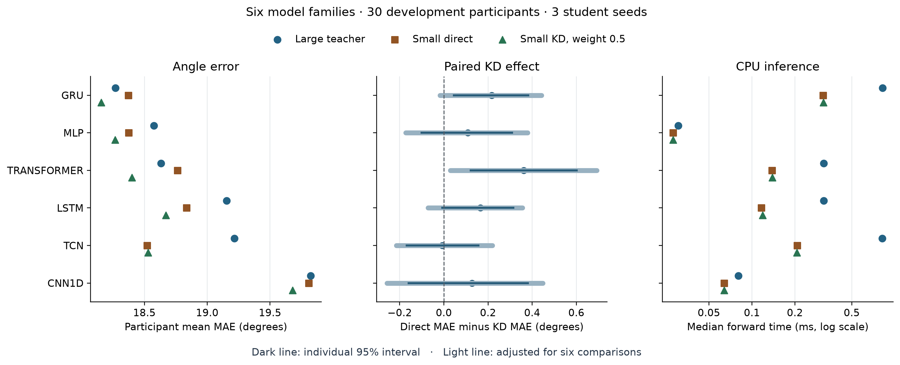

# sEMG 팔꿈치 각도 추정 — 6종 지식 증류

큰 모델의 예측을 같은 계열의 작은 모델에 증류했을 때 팔꿈치 각도 오차와 연산 시간이 얼마나 달라지는지 비교합니다. 모델마다 **큰 교사**, **작은 직접 학습 모델**, **작은 증류 모델**을 평가합니다.

현재 완료된 실험은 30명 개발 교차검증입니다. 매 분할에서 24명으로 학습하고 6명으로 평가했으며, 학생 seed 3개와 공통 증류 가중치 0.5를 사용했습니다. 학생 180조건 중 LSTM·TCN·CNN1D의 90조건을 새로 학습했고, GRU·MLP·Transformer의 90조건은 같은 프로토콜의 기존 실행에서 검증 후 가져왔습니다.

| 모델 | 큰 교사 MAE | 작은 직접 MAE | 작은 증류 MAE | 증류로 인한 MAE 감소 | 작은 증류 추론 |
|---|---:|---:|---:|---:|---:|
| GRU | 18.268° | 18.372° | **18.155°** | +0.217° | 0.317 ms |
| MLP | 18.576° | 18.375° | 18.267° | +0.108° | 0.028 ms |
| Transformer | 18.632° | 18.763° | 18.401° | **+0.362°** | 0.139 ms |
| LSTM | 19.154° | 18.835° | 18.669° | +0.166° | 0.119 ms |
| TCN | 19.215° | 18.522° | 18.529° | −0.007° | 0.206 ms |
| CNN1D | 19.823° | 19.808° | 19.680° | +0.128° | 0.064 ms |

GRU 학생의 절대 오차가 가장 낮았습니다. Transformer는 직접 학습 대비 개선 폭이 가장 컸고, 6회 비교에 대한 보정 후 조건부 개선 구간도 +0.030°~+0.692°였습니다. 체크포인트를 고른 개발 분할에서 성능도 계산했기 때문에 이 수치를 논문의 독립 시험 결과로 해석할 수는 없습니다.

작은 모델은 큰 교사보다 같은 CPU에서 약 1.1~4.0배 빨랐습니다. 이 차이는 모델 크기를 줄이는 이점입니다. 증류가 정확도에 더한 효과는 작은 직접 학습과 작은 증류를 짝지어 평가했습니다. 표의 추론 시간에는 특징 추출이나 센서 수집 시간이 포함되지 않습니다.

## 읽는 순서

| 파일 | 내용 |
|---|---|
| [6종 결과 보고서](results/six-family/README.md) | 전체 MAE·RMSE, 신뢰구간, 추론 시간, 학습 비용 |
| [논문 작성 노트](docs/MANUSCRIPT.md) | 연구 질문, 방법·결과에 넣을 내용, 남은 독립 검증 |
| [재현 가이드](docs/REPRODUCIBILITY.md) | 표 재계산, 학습 코드, 전체 재현 묶음 |
| [AI 인계 문서](AI_HANDOFF.md) | 현재 상태와 다음 실험 작업 |

## 다음 평가

원래 논문 설계는 **30명 전체 학습 후 새 10명·20명에게 평가**하는 것입니다. 전체 30명 학습과 독립 평가에 앞서 여섯 교사, 직접 학생, 증류 학생의 학습 규칙과 주 지표를 고정합니다. 새 시험 집단을 구할 때는 피험자 중복, 센서 채널, 전압 단위, 각도 정의, 기록 시간 기준을 확인합니다.

원본 데이터는 Mechtenberg 등(2023)의 공개 자료를 사용했습니다. [데이터 출처와 배포 조건](https://www.hsbi.de/publikationsserver/record/2290)
