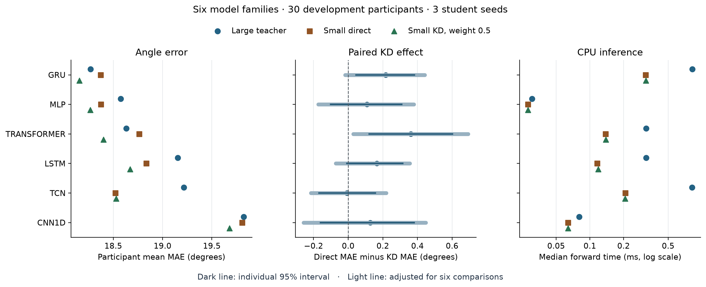

# sEMG 팔꿈치 각도 추정 — 6종 지식 증류 비교

큰 모델 6종 각각을 교사로 사용해 같은 계열의 작은 학생을 학습했다. 총 180개 학생 조건 중 LSTM·TCN·CNN1D의 90개를 새로 학습했고, GRU·MLP·Transformer의 이전 90개를 검증 후 재사용했다. 교사 30개와 학생 180개 체크포인트에서 추론 시간을 다시 측정했다.

증류 후 평균 MAE가 낮아진 모델은 5/6종이다. 가장 낮은 증류 MAE는 GRU의 18.155°다. 여섯 비교를 함께 보정했을 때 개선 구간 전체가 0보다 큰 계열은 TRANSFORMER였다.

| 모델 | 큰 교사 MAE | 작은 직접 MAE | 작은 증류 MAE | 작은 직접 → 증류 RMSE | MAE 감소 (조건부 95% 구간) | 개선 인원 |
|---|---:|---:|---:|---:|---:|---:|
| GRU | 18.268° | 18.372° | 18.155° | 23.478° → 23.228° | +0.217° [+0.045, +0.382] | 20/30 |
| MLP | 18.576° | 18.375° | 18.267° | 23.563° → 23.491° | +0.108° [-0.102, +0.309] | 17/30 |
| TRANSFORMER | 18.632° | 18.763° | 18.401° | 24.053° → 23.597° | +0.362° [+0.121, +0.602] | 23/30 |
| LSTM | 19.154° | 18.835° | 18.669° | 23.968° → 23.830° | +0.166° [-0.007, +0.315] | 23/30 |
| TCN | 19.215° | 18.522° | 18.529° | 23.776° → 23.792° | -0.007° [-0.168, +0.157] | 13/30 |
| CNN1D | 19.823° | 19.808° | 19.680° | 25.070° → 24.879° | +0.128° [-0.160, +0.381] | 18/30 |

MAE 감소는 직접 학습 MAE에서 증류 MAE를 뺀 값이다. 양수가 증류에 유리하다. 각 사람의 seed별 차이를 먼저 평균한 다음 30명을 재표집했다. 표의 구간은 개별 95% 구간이다. 아래에 여섯 비교를 함께 고려한 구간을 덧붙였다. 모델의 최적 체크포인트를 고른 분할에서 점수도 계산했다. 독립 10·20명 평가는 추가 자료가 확보되면 진행할 수 있다.

| 모델 | MAE 감소의 다중 비교 보정 구간 (°) |
|---|---:|
| GRU | [-0.018, +0.442] |
| MLP | [-0.172, +0.379] |
| TRANSFORMER | [+0.030, +0.692] |
| LSTM | [-0.071, +0.356] |
| TCN | [-0.215, +0.220] |
| CNN1D | [-0.257, +0.449] |

보정 구간은 사람 단위 부트스트랩 50,000회에 여섯 비교의 Bonferroni 보정을 적용했다. 두 종류의 구간 모두 고정 교사와 개발 자료에 조건부이며, 체크포인트 선택 및 겹치는 훈련 분할의 불확실성은 반영하지 않는다.

| 모델 | 큰 교사(ms) | 작은 직접(ms) | 작은 증류(ms) | 교사 / 증류 시간 |
|---|---:|---:|---:|---:|
| GRU | 0.822 | 0.315 | 0.317 | 2.59× |
| MLP | 0.031 | 0.028 | 0.028 | 1.09× |
| TRANSFORMER | 0.318 | 0.138 | 0.139 | 2.29× |
| LSTM | 0.318 | 0.116 | 0.119 | 2.67× |
| TCN | 0.819 | 0.208 | 0.206 | 3.97× |
| CNN1D | 0.081 | 0.064 | 0.064 | 1.26× |

CPU 4스레드, float32, 배치 1에서 체크포인트마다 준비 30회와 측정 200회를 실행했다. 표는 각 체크포인트 중앙값의 중앙값이다. 전처리와 센서 시간은 측정 범위 밖이다. 교사와 학생의 시간 차이는 작은 구조의 속도 이점을 보여 준다. 증류 효과의 주 비교는 동일 구조의 직접 학습과 증류다. 비교표 CSV에는 파라미터 수와 p95 요약도 있다.

| 모델 | 교사 학습(초) | 교사 예측값 생성(초) | 직접 학생 학습(초) | 증류 학생 학습(초) | 새 교사부터 증류까지 단계 합(초) |
|---|---:|---:|---:|---:|---:|
| GRU | 1081.8 | 47.3 | 87.5 | 100.4 | 1204.9 |
| MLP | 33.1 | 0.5 | 10.1 | 11.4 | 67.9 |
| TRANSFORMER | 1614.3 | 41.2 | 142.6 | 131.5 | 1787.0 |
| LSTM | 1046.8 | 14.7 | 20.7 | 21.6 | 1100.4 |
| TCN | 1025.3 | 24.5 | 32.2 | 34.3 | 1101.0 |
| CNN1D | 217.3 | 3.4 | 17.7 | 17.9 | 246.8 |

기록된 최적화와 검증 시간을 합쳤다. 마지막 열은 같은 분할과 seed의 실제 기록에서 교사 학습·예측값 생성·증류 학생 학습 시간을 더한 뒤 중앙값을 구했다. 병렬 실행의 영향을 받은 단계 시간이며, 프로그램 시작부터 끝까지 잰 시간과는 구분한다.

## 설계와 재현

- 한 분할의 24명으로 교사와 학생을 학습하고, 나머지 6명으로 개발 평가했다. 다섯 분할에서 30명이 평가에 한 번씩 등장한다. 정규화는 분할별 학습 인원에서 계산했다.
- 학생 seed 3개를 썼다. 같은 모델·분할·seed의 두 학생은 초기값과 배치 순서를 공유한다. 증류 손실은 표준화한 각도의 정답 MSE 50%와 교사 예측 MSE 50%를 합했다.
- 0.5는 이전 실험에서 공통으로 실행한 값이다. 기존 상위 3종의 여러 가중치 탐색은 별도 결과로 남아 있다. 이번 교사는 분할별로 고정됐다.
- 1,080개 학생 사람·seed별 오차와 180개 교사 사람별 오차를 저장 예측으로 재계산했다. 체크포인트마다 실제 입력 예제 64개로 모델 재실행을 확인했다.
- 학습 시간은 training_times.csv에 교사 최적화, 교사 표적 생성, 학생 최적화, 검증으로 기록했다. 병렬 실행과 측정 시점이 섞여 있어 전체 시간 절감의 통제 실험으로 쓰기 어렵다.
- 프로젝트 폴더에서 python -B run_six_family.py, python -B audit_six_family.py, python -B report_six_family.py 순서로 실행한다. 원본 특징과 구조는 FEATURE_CONTRACT.md를 따른다.
